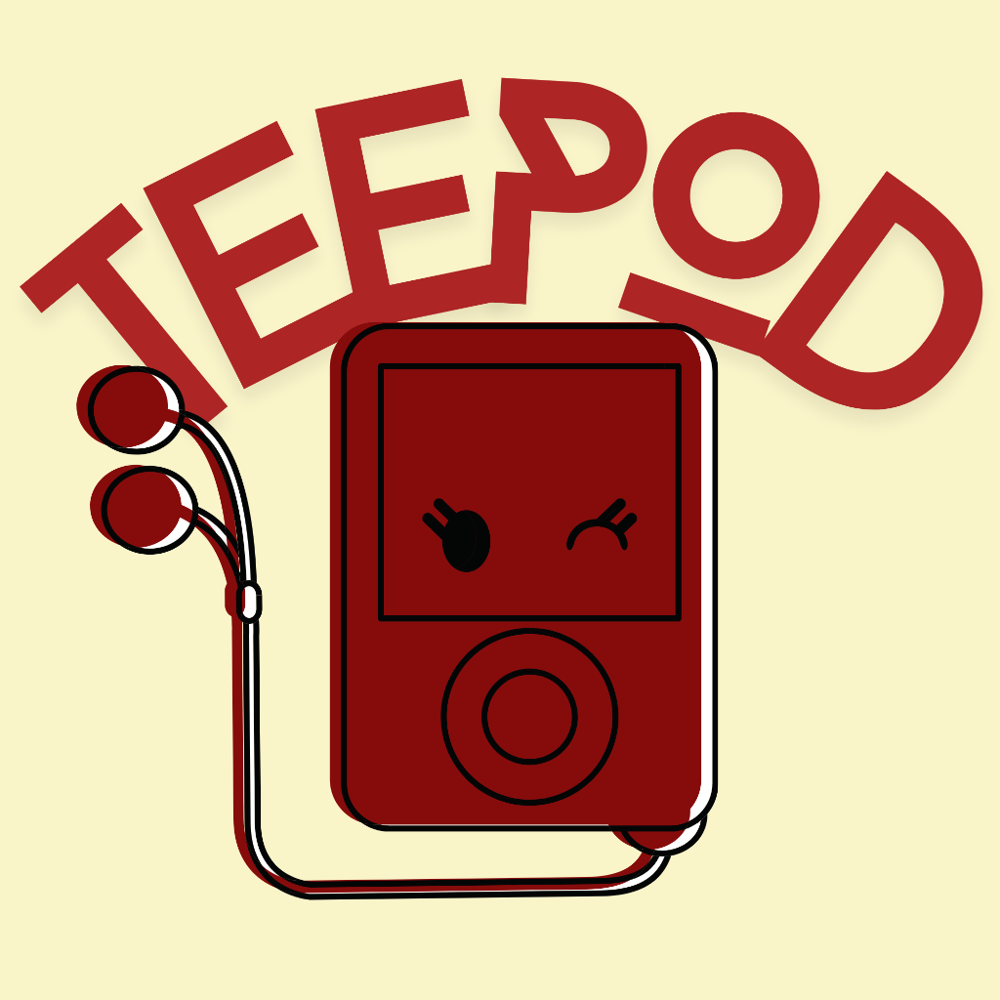

<p align="center">
  
</p>

<h1 align="center">TeePod</h1>

<p align="center">
  A customizable, retro-inspired click-wheel web music player powered by YouTube.
</p>

---

## Overview

TeePod brings the tactile experience of classic click-wheel music players to modern web browsers. Built with React, TypeScript, and Express, TeePod interfaces with the official YouTube Data API v3 for catalog search and remote-controls the official YouTube IFrame Player for audio and video playback.

The interface features custom polar-coordinate rotational gesture tracking, synthesized mechanical wheel clicks via the Web Audio API, haptic feedback, a 3D Cover Flow album carousel, and deep device customization (colors, wallpapers, and stickers).

---

## Architecture and Design

- **Search and Metadata Proxy**: Frontend clients route search queries through the server proxy (`/api/youtube/search`), keeping API secrets secure on the backend.
- **Embedded Playback Compliance**: Audio playback is driven strictly through the official YouTube IFrame Player API. No media streams are extracted or re-hosted.
- **Rotary Controller Physics**: Touch interactions measure polar angles relative to the wheel center, processing continuous angular movement with wrap-around normalization at 180 degrees.
- **Synthesized Click Feedback**: Scroll clicks and button presses utilize Web Audio API noise bursts and frequency ramps, delivering zero-latency acoustic feedback without external audio assets.
- **Persistence**: Playlists, custom colors, wallpaper selections, and sticker arrangements are saved locally via browser storage (`localStorage`).

---

## Technical Stack

- **Frontend**: React 18, TypeScript, Vite, Tailwind CSS, Framer Motion, Zustand
- **Backend**: Node.js, Express, TypeScript
- **APIs**: YouTube Data API v3, YouTube IFrame Player API, Web Audio API, Web Haptics API

---

## Environment Configuration

Create a `.env` file in the root directory (or inside `server/`):

```env
YOUTUBE_API_KEY=your_youtube_data_api_v3_key
PORT=8787
CORS_ORIGIN=*
```

### Obtaining a YouTube Data API v3 Key

1. Access the Google Cloud Console Credentials page.
2. Create a new project or select an existing project.
3. Enable the **YouTube Data API v3** in the API Library.
4. Generate an API Key under Credentials and assign it to `YOUTUBE_API_KEY`.

---

## Getting Started

### Prerequisites

- Node.js (v18 or higher)
- npm (v9 or higher)

### Installation

Clone the repository and install all dependencies:

```bash
git clone https://github.com/your-username/teepod.git
cd teepod
npm run install:all
```

### Running in Development

Start both the backend API server and frontend Vite dev server concurrently:

```bash
npm run dev
```

- Frontend interface: `http://localhost:5173`
- Backend API server: `http://localhost:8787`

---

## Building for Production

Compile both the server and client bundles:

```bash
npm run build
```

The compiled frontend assets will be output to `client/dist` and server files to `server/dist`.

---

## Deploying to Vercel

This repository is pre-configured for automated deployment on Vercel via `vercel.json` and Serverless Functions (`api/index.ts`).

### Vercel Deployment Steps

1. Push your repository to GitHub.
2. Import the project in Vercel.
3. Add the environment variable `YOUTUBE_API_KEY` under Project Settings -> Environment Variables.
4. Click **Deploy**.

---

## Credits and Author

Developed by **tee_hee**

- [GitHub](https://github.com/)
- [Instagram](https://instagram.com/)
